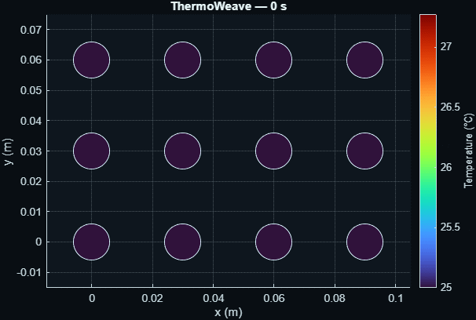
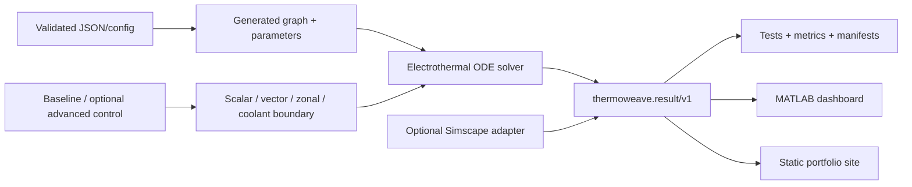

ThermoWeave models a synthetic battery assembly with thermal graphs, spatial boundaries, control, and deterministic fault studies. This companion introduces a one-node balance before the native multi-node experiments.

**[Native-source lesson guide](docs/portfolio/) · [Offline interactive lab](docs/index.html) · [Lesson configuration](docs/lesson-config.json) · [Configuration schema](docs/lesson-config.schema.json)**

[Original project interactive view](docs/original-index.html)

## Previous animations

[Open the previous-animation gallery](https://mohammadrezwankhan.github.io/thermoweave-battery-digital-twin/animations/) · [Local gallery](docs/animations/index.html)

Earlier animated artwork, waveform demos, and original interactive experiences are linked alongside the current animations.

## Your first interactive result

1. Download or clone this repository and open `docs/index.html` in a modern browser.
2. Select **Module 1**, apply its preset, and compare the declared checkpoint with the plotted result.
3. Change one slider, inspect the model assumptions, then export the configuration or telemetry for your notes.

The browser lab runs offline with no packages, accounts, or live data feeds. Its numbers are deterministic teaching simulations. Each checkpoint states its model time and tolerance; passing it demonstrates agreement with that model, not field calibration or production readiness.

## Four-module learning path

| Module | Investigation | Approximate time |
|---|---|---:|
| 1. Identify one node’s energy balance | Read a local thermal balance before adding graph interfaces. | 12 min |
| 2. Change the boundary conductance | Explain how a boundary parameter affects both steady rise and transient response. | 15 min |
| 3. Locate the limit of a pack average | Identify why a single temperature cannot reveal spatial hot spots. | 18 min |
| 4. Design a reproducible graph experiment | Carry a scalar intuition into a native study with explicit topology and evidence checks. | 18 min |

**Who this is for:** Battery thermal researchers and MATLAB learners studying topology, cooling boundaries, and numerical verification.

### Continue into the implementation

- [README.md](README.md)
- [LICENSE](LICENSE)
- [PROVENANCE.md](PROVENANCE.md)
- [buildfile.m](buildfile.m)
- [runDemo.m](runDemo.m)
- [docs/model.md](docs/model.md)
- [docs/validation.md](docs/validation.md)

### Explore or run the source

MATLAB R2024a+ for the graph core; the source records historical R2026a Update 4 evidence. Optional advanced control and Simscape features have separate product/gate requirements.

```bash
matlab -batch "startup; result = runDemo;"
matlab -batch "startup; buildtool test"
matlab -batch "startup; run3DStudy"
```

These commands come from the audited source revision. Runtime requirements and the project's own validation limits are documented below; the standalone browser lab does not execute these commands.

The detailed project guide below remains the source for installation, supported features, licences, and scientific limits. The browser equations and laboratory settings do not change the original application or numerical engine.

<details>
<summary>Project documentation, installation, attribution, and existing validation</summary>

# ThermoWeave

> Adaptive spatial electrothermal digital twin for battery cooling design


[](https://github.com/mohammadrezwankhan/thermoweave-battery-digital-twin/actions/workflows/pages.yml)

ThermoWeave is an independent MATLAB implementation for exploring how spatially and temporally varying cooling boundaries affect a synthetic multi-cell assembly. Its portable graph core supports deterministic 2-D and 3-D Cartesian lattices without Simscape Battery; an optional adapter is kept behind explicit product, library-policy, and generated-model gates.

[Interactive project site](https://mohammadrezwankhan.github.io/thermoweave-battery-digital-twin/) · [GitHub repository](https://github.com/mohammadrezwankhan/thermoweave-battery-digital-twin)



The screenshot above is generated by `tools/generateArtifacts.m` from the canonical result structure. Default local demo evidence on MATLAB R2026a Update 4: peak temperature **298.230683 K**, normalized energy-accounting residual approximately **4.39e-15**. These values describe a synthetic demonstration, not real-cell predictive accuracy.

## Why this exists

A pack-average temperature can conceal the boundary gradients, coolant warming, contact dispersion, and local faults that shape cooling decisions. ThermoWeave makes those spatial effects inspectable in a small model whose equations, units, topology, solver settings, controller constraints, random seeds, and limitations are source controlled.

## Distinct engineering contributions

- configuration-generated rectangular, staggered, cuboid, and stacked-staggered thermal graphs with axis-specific conductances and six-face masks;
- one solver interface for scalar, per-cell vector, zonal, and finite-capacity coolant-propagation boundaries;
- transparent Joule plus optional signed entropic heat with SOC evolution;
- deterministic bounded/rate-limited zonal control and an observable optimization fallback;
- seeded variability and fault events covering resistance/contact dispersion, restriction or pump loss, sensor bias/dropout, elevated heat, current imbalance, and stuck actuators;
- a canonical `thermoweave.result/v1` schema shared by tests, MATLAB UI, artifacts, and the data-driven website;
- explicit optional Simscape skip semantics rather than a fabricated integration claim.

## Architecture



The cell energy balance is

$$
C_i\dot T_i = Q_{\mathrm{gen},i}
- \sum_j G_{ij}(T_i-T_j)
- G_{b,i}(T_i-T_{b,i})
- G_{c,i}(T_i-T_{c,i}).
$$

Temperatures are kelvin internally, current is positive on discharge, and heat flow is positive into a cell. The complete derivation, coolant balance, controller objective, units, and limitations are in [`docs/model.md`](docs/model.md).

## Quick start

Requires MATLAB R2024a or newer for the core.

```matlab
startup
result = runDemo;
thermoweave.visualization.dashboard(result)
```

Run the mandatory suite and generate the same lightweight artifacts used by this README and the website:

```matlab
buildtool test
generateArtifacts
```

## Product matrix

| Capability | Requirement | Published evidence |
|---|---|---|
| Graph core, baseline control, scenarios, JSON export | MATLAB R2024a+ | Tested on R2026a Update 4 |
| Build reports and enhanced coverage | MATLAB Test where available | Installed and exercised locally |
| Advanced quadratic controller | Optimization Toolbox | Installed; transparent fallback retained |
| MPC-specific extension | Model Predictive Control Toolbox | Installed; not required by the portable core |
| High-fidelity adapter | Simulink + Simscape + Simscape Battery | Products installed; structural generation policy-gated |
| Static case-study page | Modern browser | [Pages deployment succeeded on 2026-08-14](https://github.com/mohammadrezwankhan/thermoweave-battery-digital-twin/actions/runs/31786512239) at `e181bd5` |

## Experiments and examples

The predeclared E0–E10 matrix is in [`docs/scenarios.md`](docs/scenarios.md). Five direct entry points are included:

```matlab
compareBoundaryModes
runAdaptiveCooling
runMonteCarloStudy(20)
compareCoreAndSimscape
run3DStudy
```

The independently authored E10 study uses a 3x4x3 graph with 36 thermal nodes and 75 interfaces. It compares three declared through-layer conductances under the same synthetic boundary field and exports exact scenario hashes, CSV, JSON, and figures. In this constructed case, increasing $g_z$ from 0.10 to 0.75 W/K reduces the final layer-mean spread from 4.589 K to 2.450 K. This is a sensitivity result for the stated assumptions, not measured battery accuracy.

The generated website bundle includes actual scalar, vector, zonal, coolant-restriction, and sensor-fault result records under `artifacts/web-data/`. Every displayed metric is read from that exported JSON and is tied to a scenario hash.

## Testing and CI

The published baseline records a local class-based test run of **37/37**, with 0 failed and 0 incomplete. That run covered strict configuration failure modes, equilibrium, relaxation, energy accounting and solver convergence, uniform scalar/vector equivalence, graph relabelling, coolant conservation and flow reversal, fault targeting, per-segment conductance, baseline/advanced controller bounds and a predeclared synthetic benefit, multi-interface variability, deterministic result export, schema mapping, honest Simscape status, and the 3-D topology/reduction/rendering contracts. This historical count does not include later source changes or newly added tests.

```matlab
results = runtests("tests", IncludeSubfolders=true)
buildtool
```

Core CI uses official MATLAB Actions on R2024a. At source [`e181bd54dd7b24b6ea373e747770481d3ba19f16`](https://github.com/mohammadrezwankhan/thermoweave-battery-digital-twin/commit/e181bd54dd7b24b6ea373e747770481d3ba19f16), the [Core CI run](https://github.com/mohammadrezwankhan/thermoweave-battery-digital-twin/actions/runs/31786512183) and [Documentation Pages run](https://github.com/mohammadrezwankhan/thermoweave-battery-digital-twin/actions/runs/31786512239) completed successfully on 2026-08-14. These are historical results for that source revision; the Pages badge follows `main` and is a workflow-status indicator, not a live-site availability check. Full Simscape integration is manual and targets a licensed self-hosted runner labelled `thermoweave-simscape`. See [`docs/validation.md`](docs/validation.md) for the numerical evidence and remaining validation work.

## Repository map

```text
config/                 Reproducible JSON scenarios, including the 3-D study
src/+thermoweave/       Portable package implementation
simscape/               Optional product- and policy-aware adapter
examples/               Boundary, control, Monte Carlo, adapter workflows
tests/                  Unit, integration, and regression tests
artifacts/              Lightweight generated figures, manifests, web data
docs/                   Technical docs and animated static case study
tools/                  Artifact, research-figure, documentation, and release entry points
.github/workflows/      Core, integration, Pages, and release automation
```

## Limitations and safety

ThermoWeave is a lumped reduced-order demonstrator with synthetic parameters. It does not model detailed electrochemistry, ageing, phase change, runaway chemistry, or certified safety functions. It is not a design approval tool, production controller, or substitute for test data. Controller benefits are scenario-specific. No measured held-out validation has been performed.

## Inspiration and related documentation

The project is an **independent implementation informed only by high-level thermal-network concepts** in official MathWorks documentation, including [inter-cell thermal paths](https://www.mathworks.com/help/simscape-battery/ug/inter-cell-thermal-path-workflow.html) and [scalar/vectorized thermal boundaries](https://www.mathworks.com/help/simscape-battery/ug/battery-thermal-boundary-conditions-vectorized-scalar-example.html). No source code, prose, equations, diagrams, screenshots, numerical scenarios, topology counts, model hierarchy, page structure, or example-specific names were copied. MathWorks did not sponsor or endorse ThermoWeave. See [`PROVENANCE.md`](PROVENANCE.md) and [`THIRD_PARTY_NOTICES.md`](THIRD_PARTY_NOTICES.md).

## Citation, contribution, and roadmap

Citation metadata is in [`CITATION.cff`](CITATION.cff). Contributions should follow [`CONTRIBUTING.md`](CONTRIBUTING.md), the security policy in [`SECURITY.md`](SECURITY.md), and the evidence rules in the project charter. Planned work is recorded in [`ROADMAP.md`](ROADMAP.md).

</details>
