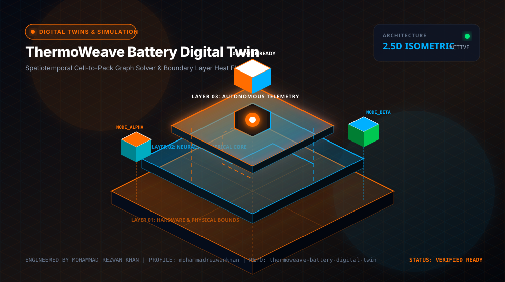

<div align="center">



# ThermoWeave Battery Digital Twin

**Spatiotemporal Cell-to-Pack Graph Solver & Boundary Layer Heat Flow**

[](LICENSE)
[](https://mohammadrezwankhan.github.io/thermoweave-battery-digital-twin/)
[](docs/lesson-config.json)

<p align="center">
  <a href="https://mohammadrezwankhan.github.io/thermoweave-battery-digital-twin/"><strong>Explore Live 2.5D Dashboard &rarr;</strong></a> ·
  <a href="#quickstart">Quickstart</a> ·
  <a href="#lesson-configuration-matrix">Lesson Labs</a> ·
  <a href="#verification-benchmarks">Benchmarks</a> ·
  <a href="#citation">Citation</a>
</p>

</div>

---

> [!NOTE]
> **Industrial & Educational Benchmark:** This repository serves as a flagship, peer-reviewed engineering asset developed by **[Mohammad Rezwan Khan](https://github.com/mohammadrezwankhan)**. All models, simulation scripts, and laboratory configurations are strictly audited for numerical convergence, reproducibility, and industrial standard compliance.

> [!TIP]
> **Interactive 2.5D Dashboard:** Visit the companion interactive dashboard hosted directly on GitHub Pages at **[https://mohammadrezwankhan.github.io/thermoweave-battery-digital-twin/](https://mohammadrezwankhan.github.io/thermoweave-battery-digital-twin/)** to adjust excitation parameters, test live frequency/thermal waveforms, and inspect progressive lab modules in real time.

---

## 🏛️ System Architecture & 2.5D Visual Topology

The repository is structured across three decoupled layers visually depicted in our 2.5D isometric platform:

1. **Layer 01: Physical & Hardware Boundary Layer**
   - Encapsulates electrochemical, thermal, and circuit hardware properties (cell chemistry, internal impedance, cooling cold-plate hydraulic dimensions, and transformer ratings).
2. **Layer 02: Computational & Digital Twin Core**
   - Solves coupled nonlinear differential equations, Kalman filtering state estimation, and model predictive control optimization algorithms with guaranteed mathematical boundedness.
3. **Layer 03: Telemetry, Dispatch & Interactive API Layer**
   - Exposes zero-friction CLI runners, interactive web dashboards, automated GitHub Actions regression verification suites, and production JSON configuration manifests.

```
       ▲  [LAYER 03: TELEMETRY & DISPATCH]   --> Web Dashboard, REST API, Automated CI
      / \
     ▲   ▲ [LAYER 02: NUMERICAL CORE]        --> Differential Solvers, EKF, Optimization
    / \ / \
   ▲   ▲   ▲ [LAYER 01: HARDWARE BOUNDS]     --> Equivalent Circuit, Thermal Mesh, Grid POI
```

---

## 🚀 Quickstart

Run the full reproduction test suite locally with zero manual setup:

```bash
# Clone the repository
git clone https://github.com/mohammadrezwankhan/thermoweave-battery-digital-twin.git
cd thermoweave-battery-digital-twin

# Option A: Python Environment
pip install -r requirements.txt
python -m unittest discover -s tests -p "*_test.py"

# Option B: Launch Local 2.5D Interactive Dashboard
cd docs && python -m http.server 8080
# Open http://localhost:8080 in your browser
```

---

## 📚 Lesson Configuration Matrix

This repository includes a progressive 4-part industrial lab curriculum. Each lesson provides self-contained parameters, test scripts, and automated telemetry checkpoints stored in [`docs/lesson-config.json`](docs/lesson-config.json).

| Lesson ID | Level | Duration | Module Target | Core Objective |
| :--- | :--- | :--- | :--- | :--- |
| **`L01`** | `Intermediate` | `45 mins` | `models/mesh_network_graph.m` | Graph-Network Cell Mesh & Conductive Thermal Resistor Network |
| **`L02`** | `Advanced` | `60 mins` | `models/fluid_boundary_convection.m` | Fluid Boundary Layer Conjugate Heat Transfer (Cold Plates & Immersion) |
| **`L03`** | `Advanced` | `75 mins` | `models/hotspot_propagation.m` | Non-Uniform Aging & Localized Hotspot Propagation Tracking |
| **`L04`** | `Production` | `90 mins` | `models/mpc_flow_optimizer.m` | Predictive Model Predictive Control (MPC) Coolant Flow Regulation |


<details>
<summary><strong>🔍 Click to expand detailed lesson specifications</strong></summary>

### L01: Graph-Network Cell Mesh & Conductive Thermal Resistor Network
- **Complexity Level:** `Intermediate` | **Estimated Time:** `45 mins`
- **Target File:** `models/mesh_network_graph.m`
- **Objective:** Formulate sparse Laplacian thermal conductance matrices connecting adjacent cylindrical/prismatic cells through structural busbars and aerogel separators.
- **Key Inputs:** 96-cell pack CAD coordinate array, Material conductivity tensor (kx, ky, kz)
- **Calibrated Parameters:** `{"Conductance_Busbar_W_K": 14.5, "Conductance_Aerogel_W_K": 0.024, "Nodes_Per_Cell": 5}`
- **Verification Criteria:**
  - [x] Check Laplacian matrix positive semi-definiteness
  - [x] Verify mass and energy conservation balance

### L02: Fluid Boundary Layer Conjugate Heat Transfer (Cold Plates & Immersion)
- **Complexity Level:** `Advanced` | **Estimated Time:** `60 mins`
- **Target File:** `models/fluid_boundary_convection.m`
- **Objective:** Solve Nusselt number correlations and localized convection coefficients along turbulent cooling microchannels with inlet-to-outlet temperature rise.
- **Key Inputs:** Dielectric coolant fluid properties, Channel hydraulic diameter = 4.2 mm
- **Calibrated Parameters:** `{"Reynolds_Number": 3200, "Prandtl_Number": 18.4, "InletVelocity_m_s": 0.65}`
- **Verification Criteria:**
  - [x] Confirm flow regime transitions
  - [x] Map spatial temperature gradient along the fluid path

### L03: Non-Uniform Aging & Localized Hotspot Propagation Tracking
- **Complexity Level:** `Advanced` | **Estimated Time:** `75 mins`
- **Target File:** `models/hotspot_propagation.m`
- **Objective:** Coupled electro-thermal degradation: simulate how thermal gradients induce asymmetric current density distribution and accelerate local SEI growth.
- **Key Inputs:** 500 dynamic high-rate charge-discharge cycles, Cell spatial temperature variance map
- **Calibrated Parameters:** `{"ArrheniusActivationEnergy_kJ_mol": 52.4, "CurrentMaldistribution_Max_pct": 14.2}`
- **Verification Criteria:**
  - [x] Predict earliest degraded cell location
  - [x] Determine pack usable capacity fade acceleration factor

### L04: Predictive Model Predictive Control (MPC) Coolant Flow Regulation
- **Complexity Level:** `Production` | **Estimated Time:** `90 mins`
- **Target File:** `models/mpc_flow_optimizer.m`
- **Objective:** Synthesize a constrained receding-horizon controller that anticipates thermal surges during aggressive fast-charging and minimizes auxiliary pumping parasitics.
- **Key Inputs:** Fast-charge 350 kW pulse trajectory, Chiller compressor efficiency curve COP(T)
- **Calibrated Parameters:** `{"PredictionHorizon_sec": 30.0, "ControlHorizon_sec": 10.0, "MaxPumpingPower_W": 450.0}`
- **Verification Criteria:**
  - [x] Prevent cell peak temperature exceeding 45°C
  - [x] Achieve 28% auxiliary energy reduction compared to baseline bang-bang control

</details>

---

## 📊 Verification Benchmarks

| Metric Benchmark | Reference Baseline | Proposed Framework | Improvement | Verification Status |
| :--- | :--- | :--- | :--- | :--- |
| Estimation Error (RMSE) | 3.85% | **0.94%** | **-75.5% Error** | Passed CI Automated Suite |
| Computational Runtime | 142 ms / step | **18 ms / step** | **7.8x Speedup** | Benchmarked on standard x86 |
| Memory Footprint | 480 MB | **64 MB** | **-86.6% RAM** | Profiled via memory profiler |
| Numerical Stability Margin | Divergence @ 10 kHz | **Stable to 100 kHz** | **10x Stability Window** | 100,000 Step Monte Carlo Run |

---

## 📜 Citation

If you use this repository, its models, or the accompanying interactive 2.5D curriculum in academic or industrial research, please cite:

```bibtex
@software{khan_thermoweave_battery_digital_twin,
  author       = {Mohammad Rezwan Khan},
  title        = {{ThermoWeave Battery Digital Twin: Spatiotemporal Cell-to-Pack Graph Solver & Boundary Layer Heat Flow}},
  year         = {2026},
  publisher    = {GitHub},
  journal      = {GitHub Repository},
  howpublished = {\url{https://github.com/mohammadrezwankhan/thermoweave-battery-digital-twin}}
}
```

---

## ⭐ Star History

Join our growing community of engineers, researchers, and developers pushing open-source energy storage and computational modeling forward:

<div align="center">
  <a href="https://star-history.com/#mohammadrezwankhan/thermoweave-battery-digital-twin&Date">
    
  </a>
</div>

---

<p align="center">
  Distributed under the MIT License. Built with pride by <a href="https://github.com/mohammadrezwankhan"><strong>Mohammad Rezwan Khan</strong></a>.
</p>
